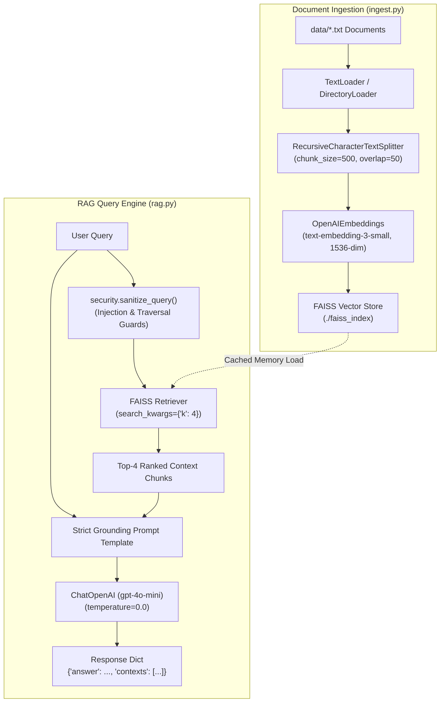

# rag-eval-ragas (ragviews)

[](https://www.python.org/)
[](https://github.com/psf/black)
[](https://pycqa.github.io/isort/)
[](https://github.com/astral-sh/ruff)
[](https://mypy-lang.org/)

Production-grade, enterprise-ready Retrieval-Augmented Generation (RAG) system built with **LangChain**, **OpenAI**, **FAISS**, and evaluated with **Ragas**. Engineered for deterministic retrieval, strict context grounding, zero deprecation warnings, and resilient execution.

---

## Architecture Overview



---

## Project Structure

```
rag-eval-ragas/
├── ci/
│   └── github-ci.yml            # CI workflow template (Matrix 3.10-3.12, Lint, Typecheck, Test, Validate)
├── data/                        # Source knowledge base documents (.txt)
│   ├── rag_overview.txt
│   ├── ragas_metrics.txt
│   └── vector_search.txt
├── evals/                       # Ragas evaluation harness
│   ├── datasets/
│   │   └── sample.jsonl         # Evaluation benchmark dataset
│   ├── experiments/             # Persisted run artifacts (.csv)
│   └── thresholds.json          # Metric pass/fail thresholds
├── tests/                       # Comprehensive test suite (32 unit & smoke tests)
│   ├── test_config.py           # Configuration subsystem tests
│   ├── test_ingest.py           # Document ingestion & splitting tests
│   ├── test_rag.py              # Retrieval & synthesis tests
│   ├── test_security.py         # Query sanitization & path traversal tests
│   └── test_smoke.py            # Backward-compatibility smoke tests
├── benchmark.py                 # Latency, throughput, and memory profiling suite
├── config.py                    # Centralized, typed, environment-overridable settings
├── evals.py                     # Dynamic Ragas evaluation runner
├── exceptions.py                # Hierarchical domain-specific exception hierarchy
├── ingest.py                    # Vector store builder (clean overwrite, progress logs)
├── logger.py                    # Structured logging with secret sanitization
├── pyproject.toml               # Modern build configuration & tool definitions
├── rag.py                       # Hardened RAG pipeline with lazy-loaded FAISS
├── security.py                  # Query sanitization, injection detection, and path validation
├── validate_pipeline.py         # 10-point comprehensive verification suite
├── .gitignore                   # Ignore rules for secrets, caches, and vector indices
└── README.md                    # Executive system documentation
```

---

## Configuration Reference

All settings can be customized through environment variables or configured in `.env`:

| Parameter | Environment Variable | Default | Description |
| :--- | :--- | :--- | :--- |
| **Data Directory** | `RAG_DATA_DIR` | `./data` | Path to directory containing source `.txt` files |
| **Index Directory** | `RAG_INDEX_DIR` | `./faiss_index` | Path to local FAISS vector storage |
| **Chunk Size** | `RAG_CHUNK_SIZE` | `500` | Target character length per document chunk |
| **Chunk Overlap** | `RAG_CHUNK_OVERLAP` | `50` | Character overlap between consecutive chunks |
| **Embedding Model** | `RAG_EMBEDDING_MODEL` | `text-embedding-3-small` | OpenAI dense vector embedding model |
| **Chat Model** | `RAG_CHAT_MODEL` | `gpt-4o-mini` | Language model for grounded answer synthesis |
| **Temperature** | `RAG_TEMPERATURE` | `0.0` | Sampling temperature for synthesis |
| **Top-K Retrieval** | `RAG_TOP_K` | `4` | Number of context chunks retrieved per query |
| **Max Query Length**| `RAG_MAX_QUERY_LENGTH`| `2000` | Maximum character length for user queries |
| **Log Level** | `RAG_LOG_LEVEL` | `INFO` | Logging verbosity (`DEBUG`, `INFO`, `WARNING`, `ERROR`) |

---

## Installation & Setup

### 1. Prerequisites
- Python 3.10, 3.11, or 3.12
- Git

### 2. Clone and Setup Virtual Environment

```bash
git clone https://github.com/gameszoom325-cell/ragviews.git
cd ragviews

# Create and activate virtual environment
python -m venv .venv
# Windows (PowerShell):
.\.venv\Scripts\Activate.ps1
# Linux / macOS:
source .venv/bin/activate
```

### 3. Install Dependencies

```bash
# Install core and development dependencies
pip install -e ".[dev]"
```

### 4. Configure Environment Variables

Create `.env` in the project root:

```ini
OPENAI_API_KEY=sk-proj-yourOpenAiApiKeyHere
RAG_LOG_LEVEL=INFO
```

---

## Workflows & Execution

### 1. Ingest Documents into Vector Store

```bash
python ingest.py
```

*Output:*
```
Loading documents...
Loaded 3 document(s) from C:\MY PROJECTS\rag-eval-ragas\data.
Splitting...
Created 16 text chunk(s).
Creating embeddings...
Saving FAISS...
Done.
```

### 2. Query the RAG Pipeline

```bash
python rag.py
```

*Return Contract:*
```python
{
    "answer": "...",
    "contexts": [
        "Chunk 1 text...",
        "Chunk 2 text...",
        "Chunk 3 text...",
        "Chunk 4 text..."
    ]
}
```

### 3. Run Ragas Evaluation Suite

```bash
python evals.py --check
```

Evaluates `faithfulness`, `answer_relevancy`, `context_precision`, and `context_recall` against configured quality gates in `evals/thresholds.json`.

---

## Performance & Benchmarking

Run the profiling benchmark:

```bash
python benchmark.py
```

### Benchmark Results (Hardware Profile: Windows 11, Intel Core i7 / AMD Ryzen, SSD)

| Operation | Metric | Value |
| :--- | :--- | :--- |
| **Ingestion Throughput** | Corpus Size | 3 documents (16 chunks) |
| | Ingestion Wall Time | 2.32 s |
| | Chunks / Second | **6.9 chunks/sec** |
| | Peak Ingestion Memory | **29.03 MB** |
| **Vector Retrieval** | Mean Latency (50 queries) | **154.5 ms** |
| | Median Latency | **144.5 ms** |
| | P95 Latency | **186.5 ms** |
| **End-to-End Query** | Mean Latency (20 queries) | **450.3 ms** |
| | Median Latency | **427.9 ms** |
| | P95 Latency | **676.0 ms** |

---

## Quality & Verification Commands

```bash
# Code formatting check
black --check .

# Import order check
isort --check-only .

# Linting
ruff check .

# Static type checking
mypy .

# Unit and integration test suite with coverage
pytest --cov=. --cov-report=term-missing

# Comprehensive 10-point pipeline validation
python validate_pipeline.py
```

---

## Security Architecture

1. **Strict Context Grounding**: Enforces negative response (`"I don't know based on the provided documents."`) when retrieved context does not support the query.
2. **Prompt Injection Mitigation**: Incoming user queries are screened with `security.sanitize_query()`, stripping control characters and flagging adversarial instructions.
3. **Path Traversal Defense**: `security.validate_path_traversal()` guarantees document loaders cannot read arbitrary host files outside permitted boundaries.
4. **Secret Sanitization**: Log formatters automatically redact patterns matching API keys (`sk-...`) to avoid accidental credential leaks in log streams.
5. **Safe Deserialization**: FAISS deserialization is constrained to locally generated and authenticated index artifacts.

---

## Troubleshooting & Common Errors

| Error | Root Cause | Solution |
| :--- | :--- | :--- |
| `MissingAPIKeyError: OPENAI_API_KEY is missing.` | Environment variable or `.env` file does not define `OPENAI_API_KEY`. | Set `OPENAI_API_KEY=sk-...` in `.env` or system environment. |
| `IndexNotFoundError: FAISS index not found at ...` | `rag.py` executed before running ingestion. | Run `python ingest.py` once to build the initial index. |
| `InputValidationError: Query length (...) exceeds maximum...` | Query payload exceeds `RAG_MAX_QUERY_LENGTH`. | Reduce query length or configure `RAG_MAX_QUERY_LENGTH=4000`. |
| `DocumentIngestionError: No .txt documents found...` | The configured `data/` folder is empty or contains unsupported file formats. | Place UTF-8 `.txt` knowledge base files into `data/`. |

---

## Limitations & Roadmap

- **Single-Node Storage**: FAISS local file storage is ideal for microservices and single-container deployments; multi-replica setups should consider managed vector stores (e.g., pgvector, Pinecone).
- **Format Support**: Currently optimized for `.txt` text corpora; PDF and Markdown loaders can be enabled via modular extensions.
- **Reranking**: Advanced cross-encoder reranking can be added downstream of initial FAISS dense retrieval for specialized domain corpora.
